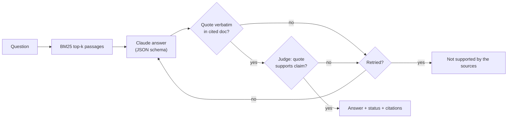

# Appendix — DecisionTrace Lite

Gnanasudharsan Ashokumar · INFO 7375 · Fall 2026 · written 2026-11-22

This is the detail behind `script.md`. Everything about DecisionTrace Lite below is
**planned**. The only parts that exist today are the six-document test pack and the
October alternatives test (`../evidence/alternatives-test/`). The larger
Neo4j/LangGraph/FastAPI system is a separate project. That it is built is my own
statement; the course repo doesn't contain it.

---

## 1. Scope

| In | Out |
|---|---|
| Synthetic corpus for one fictional company (Northwind Logistics) | Real company data of any kind |
| Python CLI: `ask "<question>"` → answer, status, cited claims | Web UI, FastAPI service, live Slack/Jira/email connectors |
| BM25 retrieval (standard library) | Vector DB, Neo4j graph, LangGraph orchestration (these stay in the larger system) |
| Claude for answering and support judgment | Any other model provider |
| Deterministic quote check, one retry, refusal | Fine-tuning or training |
| Hand-written gold set, eval harness, report with failure analysis | Claims about performance on real data |

## 2. Build plan, step by step

Each step has an "exists when" check, so progress can be shown rather than claimed. The
dates for each step should follow the instructor-published assignment briefs.

| # | Step | Exists when |
|---|---|---|
| 0 | Offline skeleton: load the 6 existing docs, chunk them, BM25 search, print the top passages | A test passes: the query "who approved the switch" ranks `2026-05-20_email.txt` first |
| 1 | Corpus: about 50 synthetic docs from a spec I write, generated with Claude Code, then read and corrected by me | `corpus/manifest.jsonl` validates against the §3.1 schema; every file has the SYNTHETIC banner |
| 2 | Gold set: about 50 hand-written questions (§3.2), at least 10 unanswerable and at least 10 status traps | `gold/questions.jsonl` validates; every gold quote is found verbatim in its doc (deterministic test) |
| 3 | Answer step: `claude -p` with `--output-format json` and `--json-schema` (§3.3), tools disabled; response saved to `runs/<run_id>/<qid>.json` | 5 questions answered; every saved response parses against the schema |
| 4 | Verifier: (a) normalized verbatim quote check in code; (b) a support-judge call per claim; (c) one retry with the failing claims listed; (d) otherwise the refusal string | Unit tests with fixture responses (labelled fixtures, not Claude output) cover pass, missing quote, wrong doc and retry-then-refuse |
| 5 | Harness: run the gold set under two configs (verify ON / OFF); score from saved files only | `python eval.py --score runs/<id>` reproduces the same numbers twice with no model calls |
| 6 | Human labels: I label support for every claim in at least 50 sampled claims, blind to the judge's verdict | `gold/human_support_labels.jsonl` exists; judge-vs-human agreement is computed |
| 7 | Report: metrics table with counts, the 10 worst failures with a cause for each, limitations | `eval/report.md` committed alongside the run IDs it summarizes |

### Pipeline



### Implementation choices

- **Chunking:** split on blank lines into paragraphs. Each chunk keeps `doc_id`, `date`, `type`
  and `title`. The date matters: ChatGPT's error in October was a wrong date.
- **BM25:** k1 = 1.5, b = 0.75 (common defaults; Robertson & Zaragoza 2009), top-k = 5. I'll
  tune k on 10 dev questions that are kept out of the scored set.
- **Quote normalization:** lowercase, collapse whitespace, unify straight and curly quotes.
  Nothing more. A paraphrase counts as a failure.
- **Retry prompt:** the same passages, plus a list of the claims that failed and why ("quote not
  found in TRK-140"). There is one retry at most, so the cost per question is bounded.
- **Status vocabulary:** `decided`, `in_progress`, `superseded`, `reversed`, `unknown`.
  `as_of` must be the date of the latest document that supports the status.
- **Offline default:** retrieval, the quote check and scoring run without any model. Saved
  model responses let anyone re-score a run without Claude access.

## 3. Data schemas

### 3.1 Corpus document (`corpus/manifest.jsonl`, one line per doc; text in `corpus/docs/<doc_id>.txt`)

```json
{
  "doc_id": "TRK-140",
  "file": "2026-06-01_ticket_TRK-140.txt",
  "type": "ticket",
  "date": "2026-06-01",
  "team": "Platform Engineering",
  "title": "Migrate Shipment Tracking Service from PostgreSQL to DynamoDB",
  "threads": ["tracking-datastore"],
  "synthetic": true,
  "generated_by": "claude-code",
  "reviewed_by_human": true
}
```

`type` ∈ `meeting_notes | email | ticket | retro | design_doc | chat_export`.
Distractor docs, like the unrelated 2026-06-15 retro, have `"threads": []`.

### 3.2 Gold question (`gold/questions.jsonl`)

```json
{
  "qid": "q001",
  "question": "Which database does the tracking service use, and why?",
  "qtype": "status",
  "thread": "tracking-datastore",
  "answerable": true,
  "gold_answer": "In transition: DynamoDB was decided 2026-05-18; migration in progress as of 2026-06-09; PostgreSQL still serves reads.",
  "gold_status": "in_progress",
  "gold_as_of": "2026-06-09",
  "gold_evidence": [
    {"doc_id": "2026-05-18_meeting_notes", "quote": "The tracking service will move from PostgreSQL to DynamoDB"},
    {"doc_id": "TRK-140", "quote": "Status: In Progress"}
  ],
  "trap": "in_progress",
  "author": "human"
}
```

`qtype` ∈ `why | when | who | status | unanswerable`.
`trap` ∈ `none | reversal | in_progress | contradiction | distractor_date | missing_fact`.
`author` must be `human` for every scored question (see §5, Threats).

q001 is built from the real test pack. TRK-140 line 7 reads `Status: In Progress`, and its
latest comment is dated 2026-06-09 ("Dual writes enabled in production."). Both were checked
on 2026-11-22. The second quote in `gold_evidence` must match the file verbatim. The
meeting-notes quote matches only after whitespace is collapsed, because the file breaks the line
after "move from". This is a ready-made unit test for the normalization rule in §2.

### 3.3 Answer contract (passed to `claude -p --json-schema`)

```json
{
  "type": "object",
  "required": ["answer", "status", "as_of", "claims", "refused"],
  "properties": {
    "answer":  {"type": "string"},
    "status":  {"enum": ["decided", "in_progress", "superseded", "reversed", "unknown"]},
    "as_of":   {"type": ["string", "null"]},
    "refused": {"type": "boolean"},
    "claims": {
      "type": "array",
      "items": {
        "type": "object",
        "required": ["text", "doc_id", "quote"],
        "properties": {
          "text":   {"type": "string"},
          "doc_id": {"type": "string"},
          "quote":  {"type": "string"}
        }
      }
    }
  }
}
```

### 3.4 Verification record (`runs/<run_id>/verify.jsonl`)

```json
{"qid": "q001", "config": "verify_on", "attempt": 1, "claim_idx": 0,
 "quote_found": true, "judge_supported": true, "judge_reason": "...",
 "final": "kept"}
```

`final` ∈ `kept | dropped | refused`.

### 3.5 Human support labels (`gold/human_support_labels.jsonl`)

```json
{"qid": "q001", "run_id": "...", "claim_idx": 0, "supported": true, "note": ""}
```

## 4. Evaluation

### 4.1 Metrics

Every metric is reported as **count / total** as well as a percentage. With about 50
questions, one question is about 2 points.

| Metric | Definition | Target (proposed) |
|---|---|---|
| Answer correctness | Answerable questions whose answer matches `gold_answer` on a short rubric (core fact present, nothing contradicted), graded by me | report; used in the comparison |
| Citation validity | Displayed claims whose `quote` is found (normalized) in `doc_id` ÷ all displayed claims | **100%** (anything lower is a bug) |
| Citation support | Displayed claims I label as supported ÷ labelled displayed claims | **≥ 90%** |
| Status accuracy | Answerable status-bearing questions with `status == gold_status` ÷ those questions | **≥ 85%** |
| As-of accuracy | `as_of == gold_as_of` (catches the ChatGPT-style wrong date) | report |
| Correct refusal | Unanswerable questions with `refused == true` ÷ unanswerable questions | **≥ 90%** |
| False refusal | Answerable questions with `refused == true` ÷ answerable questions | **≤ 10%** |
| Retrieval recall@5 | Questions where every gold evidence doc appears in the top-5 chunks ÷ answerable questions | report; diagnoses failures |
| Judge agreement | Claims where the Claude support-judge agrees with my label ÷ labelled claims (≥ 50 claims) | **≥ 85%**; if lower, report support from my labels only |
| Retry rate / usage | Share of questions that needed a retry; tokens per question from the `usage` field in the JSON output | report |

### 4.2 Comparison

There are two configurations on the same questions and the same retrieval: **verify ON**
(full tool) and **verify OFF** (answer step only, with claims shown unchecked). Each runs
once per question. If the allowance permits, I'll run 3 repeats of verify ON on the 15
trap questions to see how much results vary between runs.

### 4.3 Decision rule, written before any results

- **Worked:** verify ON meets every bold target, *and* beats verify OFF on citation support and
  status accuracy, *and* loses no more than 5 points (about 2–3 questions) of answer correctness.
- **Didn't work:** any of these:
  - verify ON's support or status accuracy isn't higher than OFF's;
  - false refusal is above 10%;
  - judge agreement is below 85%, so the automatic check can't be trusted.
- **Partial:** targets missed but the direction is right. The report says which targets and why.
- First smoke test: q001 (the October Q1) must return `in_progress`, `as_of` 2026-06-09, and a
  claim citing TRK-140.

These targets are mine to confirm. They aren't course requirements. Change them before the
first scored run, not after.

### 4.4 Threats to validity

- **Self-confirming data.** Claude Code generates the documents. Mitigation: I write every scored
  question, answer and trap by hand, and I review every document. The report states this limit.
- **Small n.** About 50 questions can show large effects only. No significance claims.
- **Judge bias.** An LLM judging its own family's output may be lenient (Zheng et al. 2023 discuss
  judge biases). Mitigation: blind human labels on at least 50 claims.
- **Synthetic ≠ real.** Nothing here shows performance on real enterprise documents.
- **Run-to-run variance.** The same prompt can give different answers. Repeats on the trap subset.

## 5. Resources

| Resource | What I have | Use | Cost |
|---|---|---|---|
| Claude | My Northeastern Claude Code seat (no separate API credits) | Doc generation; answer and judge calls via `claude -p` (non-interactive) | No extra spend. Counts against my Claude Code usage limits. **Scripted use pending confirmation** (see below) |
| Compute | MacBook Pro, Apple M4, 16 GB RAM, no GPU | BM25, verification, scoring, all local | none |
| Accounts | GitHub (course repo fork) | Code, data, report | free |
| Not needed | Anthropic API key, cloud, GPU, Neo4j | — | — |

**Claude Code version checked:** 2.1.330 on 2026-11-22. `claude --help` lists `-p/--print`, `--output-format`
and `--json-schema`.

**Status of scripted Claude Code use: PENDING.** Confirmation is pending from my professor and NEU IT on
whether my NEU Claude Code seat may be driven from a script (`claude -p` in a loop) for this project.
Until they answer, the plan doesn't assume it's allowed.

- **If it's allowed:** run as planned above.
- **If it isn't:** request Anthropic API credits for the project, and switch the two call sites (answer and
  judge) from `claude -p` to direct Messages API calls with the same JSON schema. Retrieval, the quote check,
  the saved-response format and scoring stay the same, so only the caller changes. While waiting, steps 0–2
  (offline skeleton, corpus, gold set) and the deterministic tests need no model calls at all, so the
  project isn't blocked.
- **Either way:** the film and report say which path was used.

**Also check before the first scored run:**
1. What the usage limits are on the NEU plan, so you know how many calls fit in a day.
2. The exact flag to disable tools in `-p` mode (`--allowedTools` / `--disallowedTools` appear in
   `--help`). Test it on one call first.

**Usage estimate (an estimate, not a measurement).** Per question, per config: one answer call
(about 2–3k input tokens of passages and instructions, plus about 0.5k output) and about 3 judge calls
(about 0.6k each), plus a retry on some questions. Claude Code adds its own system prompt to every
`-p` call, which may dominate. Measure it from the `usage` field of the first saved response
before planning the full runs. Rough order: 50 questions × 2 configs × about 4 calls ≈ 400 calls per full
run. Plan for at most 3 full runs, and spread them over days.

## 6. Prior work and references

The confidence column says how sure I am that the item exists as described. **VERIFY** means
check it before it goes in the film. Product claims need a dated primary source (course rule).
I didn't check any link in this session.

### Your own evidence (exists, in this repo)

| Item | Where |
|---|---|
| Alternatives test: NotebookLM and ChatGPT on 6 synthetic docs, 4 questions, 2026-10-09; screenshots 2026-10-10 | `../evidence/alternatives-test/` (`alt-notes.md`, `screenshots/`) |

### Research

| Reference | What it did | Confidence |
|---|---|---|
| Lewis, P. et al. (2020). *Retrieval-Augmented Generation for Knowledge-Intensive NLP Tasks.* NeurIPS 2020. arXiv:2005.11401 | Combined a retriever with a generator. Strong results on open-domain QA | High |
| Gao, T., Yen, H., Yu, J., Chen, D. (2023). *Enabling Large Language Models to Generate Text with Citations* (ALCE). EMNLP 2023. arXiv:2305.14627 | Benchmark plus citation recall/precision metrics | High |
| Es, S., James, J., Espinosa-Anke, L., Schockaert, S. (2023). *RAGAS: Automated Evaluation of Retrieval Augmented Generation.* arXiv:2309.15217 (EACL 2024 demo) | Reference-free faithfulness, answer relevance and context relevance metrics | High (venue: VERIFY) |
| Liu, N. F., Zhang, T., Liang, P. (2023). *Evaluating Verifiability in Generative Search Engines.* Findings of EMNLP 2023. arXiv:2304.09848 | Human audit of generative search engines. My recollection: about 51.5% of sentences fully supported by citations, about 74.5% of citations supporting their sentence | High that it exists. **VERIFY the numbers.** Cut from the film (old L12) until checked |
| Min, S. et al. (2023). *FActScore.* EMNLP 2023. arXiv:2305.14251 | Breaks text into atomic facts and scores each against a source. Similar to my per-claim check | High |
| Manakul, P., Liusie, A., Gales, M. (2023). *SelfCheckGPT.* EMNLP 2023. arXiv:2303.08896 | Detects hallucination by sampling consistency, with no retrieval | High |
| Zheng, L. et al. (2023). *Judging LLM-as-a-Judge with MT-Bench and Chatbot Arena.* NeurIPS 2023 D&B. arXiv:2306.05685 | Judge agreement with humans; position and self-enhancement biases | High |
| Robertson, S., Zaragoza, H. (2009). *The Probabilistic Relevance Framework: BM25 and Beyond.* Foundations and Trends in IR 3(4) | BM25 reference | High |
| Bohnet, B. et al. (2022). *Attributed Question Answering.* arXiv:2212.08037 | Framing and evaluation of QA that must attribute its answers | Medium, **VERIFY** |
| Rashkin, H. et al. *Measuring Attribution in Natural Language Generation Models* (AIS). arXiv:2112.12870; Computational Linguistics 2023 | "Attributable to identified sources" human-eval framework | Medium, **VERIFY** |
| Nygard, M. (2011). *Documenting Architecture Decisions* (blog post introducing ADRs) | Practice of recording decisions and their status (proposed/accepted/superseded) | High that it exists. **VERIFY the URL** |

### Products (only NotebookLM and ChatGPT are named in the film, at L09; the rest are appendix-only until verified)

| Product | Claim made in film | Confidence |
|---|---|---|
| NotebookLM (Google) | Answers over uploaded sources, with citations | High. I tested it myself 2026-10-09 |
| ChatGPT (OpenAI) with file uploads | Answers over uploaded files | High. Tested 2026-10-09 |
| Microsoft 365 Copilot | Answers over an organization's Microsoft 365 content | High. **VERIFY the current feature page, and date it** |
| Glean | Enterprise search and assistant over company apps | High. **VERIFY, and date it** |
| Atlassian Rovo | AI search/agents over Atlassian and connected content | Medium-high. **VERIFY, and date it** |

### Anthropic (related; not used, because no API credits)

| Item | Relevance | Confidence |
|---|---|---|
| Citations feature on the Claude API (announced early 2025) | Native passage-level citations: the API-credit alternative to my quote check | Medium-high. **VERIFY the date and docs URL** |
| "Introducing Contextual Retrieval" (Anthropic engineering post, 2024) | Shows BM25 alongside embeddings helps retrieval | Medium-high. **VERIFY the numbers before quoting any** |
| Claude Code headless / non-interactive (`-p`) docs | The mechanism I use instead of API calls | Flags confirmed locally via `claude --help` (v2.1.330). **VERIFY the docs URL** |

Not used, and deliberately left out of the film: any claim about how accurate these products
are in general. My October test covers 6 documents and 4 questions, and the script keeps to that.
